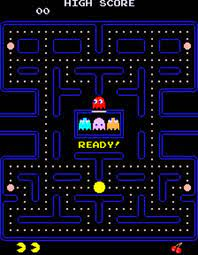

# Python Pacman

A classic, retro arcade-style **Pacman** implementation built entirely in Python. Navigate the maze, gobble up pellets, avoid the ghosts, and chase high scores in this faithful recreation of the arcade legend!

---

## Features
- **Classic Gameplay:** Grid-based movement mechanics, power pellets, and scoring systems.
- **Ghost AI:** Ghosts track and navigate through the maze to hunt the player.
- **Retro Visuals:** Clean, arcade-inspired UI and game board layout.
- **Score Tracking:** Keeps track of your current score and high score.

---

## Gameplay Screenshot
 

## Getting Started

### Prerequisites
Make sure you have Python installed on your system (Python 3.8+ recommended).

### Installation & Running Locally

1. **Clone the repository:**
   ```bash
   git clone [https://github.com/your-username/PythonPacman.git](https://github.com/theamitabhgarg/PythonPacman.git)
   cd PythonPacman
   pip install pygame
   python pacman.py

2. **Controls:**
    **Arrow Keys (↑, ↓, ←, →) or W, A, S, D** to steer Pacman through the maze.

## Created By
Created by Amitabh Garg.
